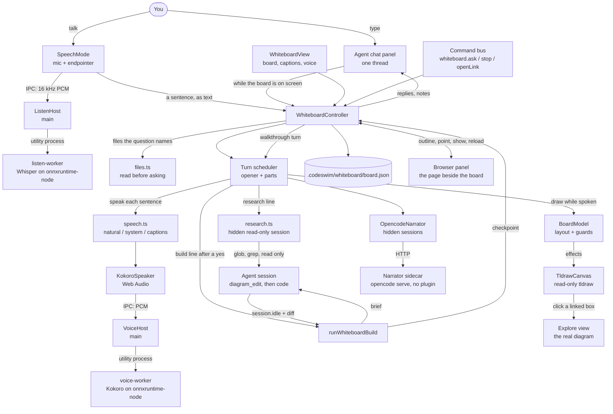

The Whiteboard view is where you talk through what to build. The narrator
answers out loud and sketches the design on a read-only tldraw canvas, lays
real choices side by side for you to make, and, once you say yes, hands an
agreed design brief to the workspace's agent. The agent builds it the usual
way (`diagram_edit` first, then code) while the whiteboard stays quiet. At the
checkpoint the narrator walks you through what changed on a new page, with
links to the real diagram and the diff.

The whiteboard narrates the *design*, never the agent typing, and the canvas
is not a source of truth: mermaid diagrams stay the spec. Only the narrator
draws; you pan, zoom, flip pages, and click linked boxes to open the real
diagram. Plan and rationale: [plans/talking-whiteboard.md](../plans/talking-whiteboard.md).

## Source

- [packages/whiteboard](../packages/whiteboard/src/index.ts): the pure,
  tested core (no Electron, no tldraw):
  - the line protocol and its parser ([protocol.ts](../packages/whiteboard/src/protocol.ts))
  - the board model ([board.ts](../packages/whiteboard/src/board.ts))
  - the guards ([guards.ts](../packages/whiteboard/src/guards.ts))
  - the turn scheduler ([turn.ts](../packages/whiteboard/src/turn.ts))
  - the brief and checkpoint ([checkpoint.ts](../packages/whiteboard/src/checkpoint.ts))
  - the page beside the board: its prompt block, page lines and before/after
    diff ([page.ts](../packages/whiteboard/src/page.ts))
  - files the person names, found and cut to size ([files.ts](../packages/whiteboard/src/files.ts))
  - speech mode's endpointer and transcript cleanup ([listen.ts](../packages/whiteboard/src/listen.ts))
  - the prompts ([prompts/](../packages/whiteboard/src/prompts/index.ts)):
    [system](../packages/whiteboard/src/prompts/system.ts),
    [opener](../packages/whiteboard/src/prompts/opener.ts),
    [after-opener](../packages/whiteboard/src/prompts/after-opener.ts) and
    [walkthrough](../packages/whiteboard/src/prompts/walkthrough.ts)
- Renderer: the view, controller, tldraw canvas, narrator transport, speech,
  build hand-off and research ([research.ts](../apps/desktop/src/renderer/src/whiteboard/research.ts))
  under [whiteboard/](../apps/desktop/src/renderer/src/whiteboard/controller.ts),
  and the shared thread in the Agent panel
  ([chat/thread.ts](../apps/desktop/src/renderer/src/chat/thread.ts),
  [ChatPanel.tsx](../apps/desktop/src/renderer/src/components/ChatPanel.tsx)).
- The natural voice:
  - renderer: [voice.ts](../apps/desktop/src/renderer/src/whiteboard/voice.ts)
    (choice and install status),
    [kokoro-speaker.ts](../apps/desktop/src/renderer/src/whiteboard/kokoro-speaker.ts),
    [pronounce.ts](../apps/desktop/src/renderer/src/whiteboard/pronounce.ts)
  - main: [voice.ts](../apps/desktop/src/main/voice.ts),
    [voice-worker.ts](../apps/desktop/src/main/voice-worker.ts),
    [voice-worker-loop.ts](../apps/desktop/src/main/voice-worker-loop.ts),
    [voice-protocol.ts](../apps/desktop/src/main/voice-protocol.ts),
    [stubs/sharp.ts](../apps/desktop/src/main/stubs/sharp.ts),
    [model-env.ts](../apps/desktop/src/main/model-env.ts) (bundled or downloaded models)
  - build: [fetch-models.mjs](../apps/desktop/scripts/fetch-models.mjs)
- Speech mode:
  - renderer: [speech-mode.ts](../apps/desktop/src/renderer/src/whiteboard/speech-mode.ts)
    (mic, turn-taking), [SpeechMode.tsx](../apps/desktop/src/renderer/src/components/SpeechMode.tsx)
    (the sound-wave button and listening bar)
  - main: [listen.ts](../apps/desktop/src/main/listen.ts),
    [listen-worker.ts](../apps/desktop/src/main/listen-worker.ts),
    [listen-worker-loop.ts](../apps/desktop/src/main/listen-worker-loop.ts),
    [listen-protocol.ts](../apps/desktop/src/main/listen-protocol.ts)
- Main: the narrator sidecar
  ([sidecar.ts](../apps/desktop/src/main/sidecar.ts),
  `startNarratorSidecar`) and board persistence
  ([whiteboard-file.ts](../apps/desktop/src/main/whiteboard-file.ts)).

## How a turn works

Pareto doesn't stream, so a turn sends two requests at once. A one-sentence
*opener* comes back in 1.5–2.5 s and is spoken while the *main* answer is
still being generated. The main answer arrives in parts of at most three
sentences, and each next part is requested as soon as the previous one
lands. Drawing waits until the opener has played. Each request carries the
conversation, a `<canvas>` summary in grid terms, and a `<project>` list of
the workspace's real diagrams, so boxes can link to them.

## One conversation, in the Agent chat

There's no separate whiteboard chat. While the Whiteboard is on screen, the
Agent panel's chat box talks to the narrator. Opening the board opens the
chat, and a Whiteboard/Agent switch above the box sends a single message
straight to the agent instead. The narrator's replies and status notes land
in the same thread as the agent's messages, merged by time. Each entry is
tagged with the chat session it was said in, so it only shows in that
session. A build hand-off shows as a short "Whiteboard → Agent" card, and
the brief carries the recent whiteboard conversation, so the agent can later
answer "why did we pick Postgres?" from what was actually said. The narrator
is still its own fast model behind the scenes.

## Reading code

The narrator has no tools, because every tool call is another multi-second
round trip on a model that doesn't stream. It still answers from real code,
two ways:

- **Files you name are read first.** "What does `styles.css` do?" pulls in
  up to 3 named files (exact paths, file names, or a folder's listing), capped
  in size, as a `<files>` block. The answer comes from the file at the usual
  speed.
- **Everything else goes to a read-only agent.** For "where do we check
  permissions?", the narrator says it'll have the agent look and emits
  `{"research":"…"}`. A hidden session starts on the workspace's opencode
  server. It's titled `codeswim:research`, so it never shows in the session
  list, and it's deleted afterwards. Its message carries
  `tools: {"*": false, read, grep, glob}`, and opencode enforces that by
  offering only those tools. While it runs (with a 2-minute limit, and Stop in
  the chat and on the board), you can keep talking. When it's back, the
  narrator reports the answer from a `<research>` block, sketches it, and
  links boxes to the files the agent read. If the board isn't showing, it
  waits like a finished build. Only one look runs at a time.

## The page beside the board

When the browser panel shows a page, usually the person's own dev server, the
narrator can talk about it: "here's your landing page, the buttons are 220
pixels wide".

- **What it's told.** Each main request carries a `<page>` block: the page's
  url and title, its headings, buttons, links and inputs by text, and sizes
  for the things whose size matters. It's an outline from the panel's isolated
  world, not a screenshot, so it's cheap and fast. With no page open, the
  block says where the app is running. If nothing is running, it names the
  project's dev-server scripts the narrator may start.
- **Starting the app.** "Show me the landing page" with nothing running:
  the narrator says it's starting the app and emits `{"start":"dev"}`. The app
  starts that run without leaving the whiteboard, waits up to 45 s for it to
  print a local address, opens the address beside the board, and asks the
  question again with the page in view. It only starts runs that look like dev
  servers (`looksLikeServer`: never build, test or deploy), and only while no
  other script is running, since starting one stops whatever runs.
- **Pointing.** `{"point":"Sign up"}` rings the element with that text while
  the sentence about it is spoken (`"all":true` rings every match).
  `{"show":"…"}` opens a page, but only a local address or another page of
  the site already showing (`canShow`).
- **Measured, not guessed.** When a build starts with a page open, the
  controller outlines the page. When the build finishes, it reloads the page,
  outlines it again, and puts the difference in the checkpoint, for example
  `button "Sign up" (all 2): size 220×44 → 260×44 px`. The walkthrough states
  those numbers and points at the changed elements. For a small visual change
  it skips the new board page.
- **Follow-ups.** For two questions after a walkthrough, a direct change
  request ("actually, make them even wider") counts as the go-ahead
  (`asksForChange`). A question about options ("what if we…") still doesn't.
  The window is never restored from a saved board, because a build from an
  earlier session isn't "just built".

## The natural voice

The default voice is Kokoro-82M (Apache-2.0), running locally. The system
voice speaks until it's loaded, and muting turns either into captions.

- **It ships with the app.** `scripts/fetch-models.mjs` fetches the fp16
  model (163 MB) and Whisper (77 MB) into `apps/desktop/models`, pinned to a
  revision and checked by size and sha256; the `build:*` scripts run it,
  release CI caches it, and electron-builder puts the folder next to the
  asar. The worker reads it from there with network fetching off, and the
  voice loads by itself in under a second. A dev checkout without
  `npm run fetch:models` falls back to the old flow: the view offers a
  one-time download into `userData/kokoro`, never automatically.
- **Synthesis runs in a utility process** (`voice-worker.ts`), so main never
  blocks: about 0.5 s a sentence on Apple Silicon, 7–8x real time.
  kokoro-js and transformers.js are bundled into that worker, `sharp` is
  stubbed out, and only onnxruntime-node ships as a native dependency, with
  this OS's binaries only.
- **No gaps between sentences.** The scheduler calls `prepare()` as soon as a
  sentence is queued, so the next one renders while the current one plays.
  Stock phrases (fillers, the walkthrough opener, the build question) render
  once at low priority and are kept.
- **Audio playback.** It comes back as 24 kHz PCM over IPC and plays through
  Web Audio, so the CSP is unchanged.
- **Pronunciations.** `.codeswim/pronunciations.json` fixes product names, as
  `{ "words": { "codeswim": "code swim", "Kokoro": "/kˈOkəɹO/" } }`. A value
  is a respelling, or IPA between slashes. A missing file or bad entry is
  skipped.

## Speech mode

The sound-wave button (in the chat box and on the board's strip) turns on a
hands-free conversation: you talk, the narrator answers out loud, and it
listens again when it's done. While it's on, a listening bar with a live
level meter stands in for the chat box; End turns it off, and so does
leaving the board.

- **Speech recognition is local.** Whisper base.en (Apache-2.0, q8, 77 MB)
  runs in its own utility process (`listen-worker.ts`), the same way the
  natural voice does: about 0.4 s to transcribe a 5 s sentence on Apple
  Silicon. It ships with the app like the voice; without the bundled copy,
  the first press offers a download into `userData/whisper`.
- **The renderer decides when you've finished.** The mic (echo-cancelled,
  16 kHz, 64 ms frames) feeds an `Endpointer` that learns the room's noise
  floor, ignores clicks shorter than 250 ms, ends a sentence after an 800 ms
  pause and keeps 300 ms from before it started. Only finished sentences go
  to main.
- **Half-duplex on purpose.** While the narrator talks, what the mic hears
  is dropped, and listening resumes 500 ms after it stops. Echo cancellation
  doesn't reliably remove the OS voice, and the narrator would answer
  itself. Tapping the bar ("Answering · tap to interrupt") or Esc stops it.
- **Sounds that aren't words are dropped.** `cleanTranscript` removes
  Whisper's sound tags and the phrases it invents from silence ("Thank
  you.", "Thanks for watching!"). What's left goes through `whiteboard.ask`,
  exactly like a typed message, so the build guard sees the person's own
  words.
- **Microphone access.** macOS asks once (`mic:access`). The packaged app
  carries the audio-input entitlement and a usage string. If access was
  refused, the bar says where to allow it.

## Rules enforced in code

The prototype found the model breaks each of these even when told not to:

- The board is only cleared when you asked.
- `pick` only names an option that was actually offered.
- A `build` line is honored only when your own last message said yes, or,
  right after a walkthrough, asked for a change outright. Otherwise the
  narrator asks first. `whiteboard.ask` is human-only on the command bus, so
  an agent can't say yes for you.
- `show` only opens the person's running app or the site already showing.
- Labels are plain words, and colors and shapes are mapped to tldraw's set.
- Boxes never overlap, and arrows curve around boxes in their way.
- An answer that repeats the opener loses the repeat.

## Why a separate narrator process

opencode 1.18 appends the instruction files, the environment block and the
workspace's `AGENTS.md`/`CLAUDE.md` *after* the plugin's system-prompt hook,
so the coding agent's sidecar can't give the narrator a clean prompt. The
narrator runs as its own `opencode serve`. It uses the same binary and auth
store, so the Unbiased key never crosses IPC. It has no plugin, no
instructions, Claude-compat prompt files off, and an empty working
directory. That cut the narrator's system prompt from about 34k to 7k
characters.

## Notes

- tldraw needs a license key in packaged builds (`VITE_TLDRAW_LICENSE_KEY`).
  Without one it hides the editor after a few seconds, and the view says so.
  Dev builds work without a key. The board model is canvas-agnostic, so
  swapping libraries means replacing `tldraw-canvas.ts` alone.
- The view is lazy-loaded, so tldraw (about 4 MB) only loads when the
  Whiteboard opens. Its fonts and translations are bundled, not fetched from
  a CDN, so the CSP is unchanged.
- `.codeswim/whiteboard/` carries its own `.gitignore`, so design
  conversations stay local unless you delete it.
